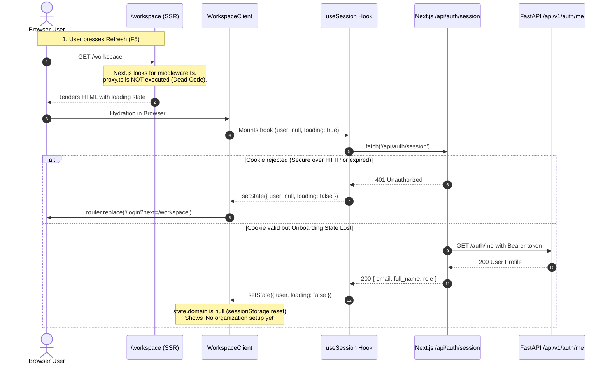
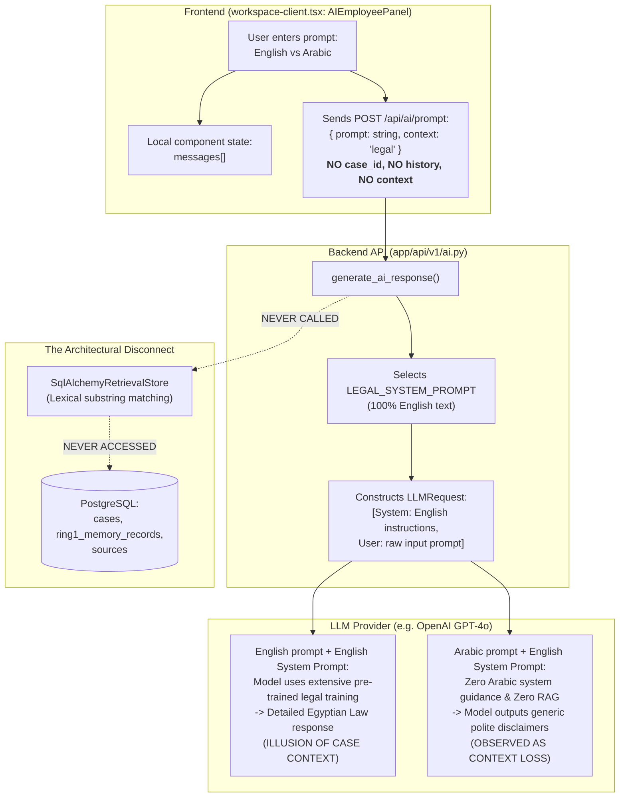
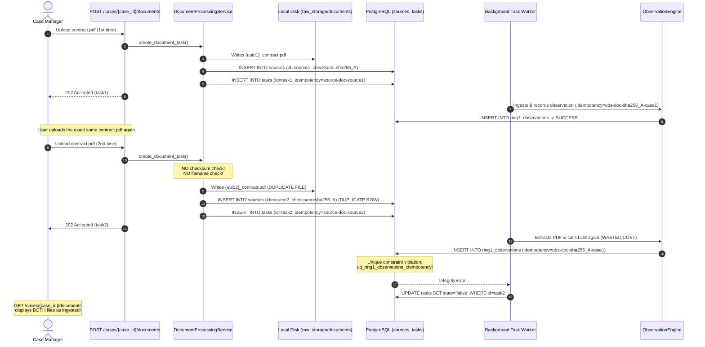
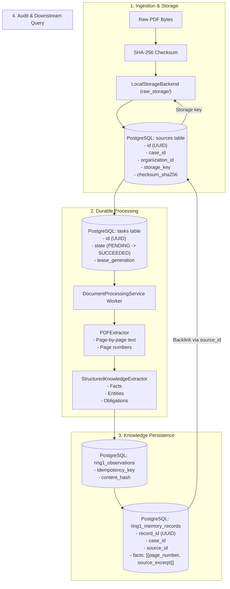
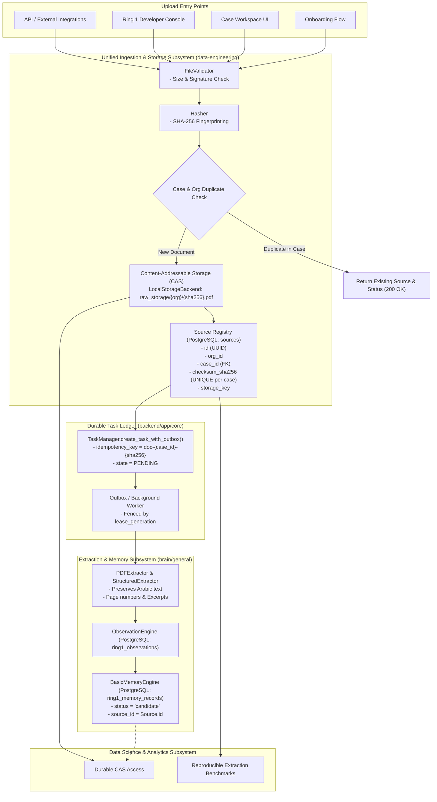
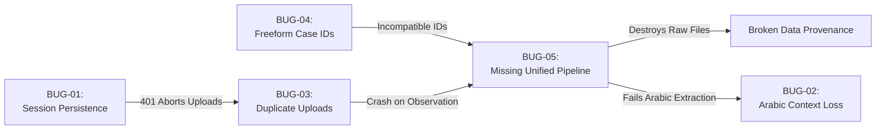

# Technical Investigation Report: Authentication, AI Context, Case Management & Unified Data Ingestion

**Document Identifier:** `AUDIT-2026-11-17-TECH-INV-01`  
**Date:** 2026-11-17  
**Author / Role:** Senior Software Architect, Backend Engineer, Frontend Engineer, AI Systems Engineer & Data Engineering Auditor  
**Repository Branch:** `investigate_bugs_data_pipeline`  
**Current HEAD:** `21f694a79234e5768a5edb5a52800073c8086525`  
**Scope:** Root Cause Analysis & Cross-System Architectural Audit of BUG-01 through BUG-05  

---

## 1. Executive Summary

An exhaustive technical investigation was conducted across the Brain-Co Organizational Brain codebase (`backend/`, `frontend/`, `ai/`, `brain/`, `data-engineering/`, and `data-science/`) to evaluate five reported critical issues. Every conclusion in this report is supported by verified source code, database migrations, and structural execution traces.

### Summary Assessment Matrix

| Issue ID | Title | Verified Status | Severity | Primary Root Cause Component |
| :--- | :--- | :--- | :--- | :--- |
| **BUG-01** | Authentication Session Persistence | **CONFIRMED** | **HIGH** | `frontend/src/proxy.ts`, `frontend/src/app/api/auth/login/route.ts`, `frontend/src/components/workspace/workspace-client.tsx` |
| **BUG-02** | Arabic Case AI Employee Context Loss | **CONFIRMED (ARCHITECTURAL DEFECT)** | **CRITICAL** | `frontend/src/components/workspace/workspace-client.tsx`, `backend/app/api/v1/ai.py`, `brain/src/brain/extensions/legal/extractor.py`, `backend/app/infrastructure/database/stores.py` |
| **BUG-03** | Duplicate Document Uploads | **CONFIRMED** | **HIGH** | `backend/app/services/document_processing_service.py`, `backend/app/api/v1/cases.py`, `backend/migrations/versions/e819b932c01a_create_sources_table.py` |
| **BUG-04** | User-Controlled Internal Case IDs | **CONFIRMED** | **MEDIUM-HIGH** | `backend/app/schemas/case.py`, `backend/app/api/v1/cases.py`, `backend/app/api/v1/ring1.py`, `backend/migrations/versions/b39c4d5e6f7a` |
| **BUG-05** | Missing Unified Data Ingestion Pipeline | **CONFIRMED (SYSTEMIC ARCHITECTURAL FRACTURE)** | **CRITICAL** | Fragmentation across `backend/app/api/v1/sources.py`, `backend/app/api/v1/ring1.py`, `backend/app/api/v1/cases.py`, and `data-engineering/orgbrain_ingest/` |

### Core Architectural Findings
1. **BUG-01 (Auth Session Loss)**: Next.js middleware is located at `frontend/src/proxy.ts` using `export async function proxy`. In Next.js 16.4.0, middleware must strictly reside in `middleware.ts` (or `src/middleware.ts`) exporting `middleware`. `src/proxy.ts` is **completely ignored as dead code**. Protected routes render on the client un-guarded. In `WorkspaceClient`, `useSession` triggers client-side `/api/auth/session` calls without a shared Context Provider. On reload, if the cookie carries `Secure` over HTTP (or cross-port mismatch), the 401 response forces an immediate client redirect to `/login`. Furthermore, `state.domain` is stored in ephemeral `sessionStorage`; any fresh tab or direct login loses the onboarding context and prompts the user to re-onboard.
2. **BUG-02 (Arabic Context Loss)**: The Case AI Employee (`AIEmployeePanel` in `workspace-client.tsx`) and the backend endpoint `POST /api/v1/ai/prompt` (`ai.py`) **have zero retrieval or case context injection in any language**. No `case_id`, conversation history, or document memory is passed to the LLM. In English, foundation models (e.g. GPT-4o) generate plausible Egyptian Civil Law answers from their training weights, creating an illusion of grounding. In Arabic, without Arabic system prompting or context, the model produces generic disclaimers. Furthermore, the deterministic extractor translates Arabic citations (`المادة 147`) into English statements (`Cites Article 147 of Egyptian Civil Code`), and `SqlAlchemyRetrievalStore` performs raw substring searches (`t in text_repr`), causing Arabic keyword queries to return zero matches.
3. **BUG-03 (Duplicate Document Uploads)**: Neither `POST /api/v1/cases/{case_id}/documents` nor `DocumentProcessingService.create_document_task` checks whether a file with the same SHA-256 checksum or name already exists in the case. Duplicate uploads write new physical files to disk, insert duplicate `Source` records, and spawn duplicate background tasks. When the worker attempts to record observation events, PostgreSQL raises an `IntegrityError` on the unique index `uq_ring1_observations_idempotency`, permanently failing the task while leaving orphaned physical files and `sources` rows.
4. **BUG-04 (User-Controlled Case IDs)**: Case creation accepts user-supplied string `case_number` (`CaseCreate`). Concurrency races on `case_number` can cause unhandled PostgreSQL `IntegrityError` exceptions on `uq_cases_org_number`. Critically, `cases.id` is a UUID, while `sources.case_id`, `tasks.case_id`, `ring1_observations.case_id`, and `ring1_memory_records.case_id` are unconstrained freeform `String` columns without foreign keys. In `ring1.py`, clients pass freeform strings like `"case-legal-101"`, creating partitioned memory records that can never be queried by `cases.py`.
5. **BUG-05 (Unified Ingestion Pipeline)**: The standalone Data Engineering ingestion pipeline in `data-engineering/orgbrain_ingest/` is only invoked by `POST /api/v1/sources`. The other file ingestion paths (`POST /api/v1/cases/{case_id}/documents` and `POST /api/v1/ring1/upload-pdf`) completely bypass it. In the Ring 1 Test Console, files are processed **purely in RAM and discarded upon connection close**, destroying original file provenance and making it impossible for Data Science to reproduce extractions or build datasets.

---

## 2. Repository and Git State

- **Repository Root:** `/home/mohamed-alaa/.gemini/antigravity/worktrees/brain-co/investigate_bugs_data_pipeline`
- **Active Branch:** `investigate_bugs_data_pipeline`
- **Current HEAD Commit:** `21f694a79234e5768a5edb5a52800073c8086525` (`Merge branch 'fix/f-007a'`)
- **Active Git Worktrees:**
  1. `/home/mohamed-alaa/Desktop/brain-co` (`8db328c2` on `[feat/ring1-remediation-pdf-pipeline]`)
  2. `/home/mohamed-alaa/.gemini/antigravity/worktrees/brain-co/brain_module_technical_audit` (`23b9454b` on `[brain_module_technical_audit]`)
  3. `/home/mohamed-alaa/.gemini/antigravity/worktrees/brain-co/investigate_bugs_data_pipeline` (`21f694a7` on `[investigate_bugs_data_pipeline]`)
  4. `/tmp/brain-co-webapp-test` (`05a17d11`, detached HEAD)
- **Worktree Status:** `git status` clean; 0 staged, 0 unstaged, 0 untracked modifications.
- **Safety Protocol Adherence:** Zero destructive commands executed. No existing application files, migrations, or database records were modified or deleted.

---

## 3. Investigation Methodology

The investigation was structured around static code auditing, architectural protocol tracing, database schema inspection, and environment verification:
1. **Frontend Authentication & State Tracing:** Inspected Next.js route handlers, middleware configuration, hooks (`useSession`, `useOnboarding`), form submissions, cookie options, and hydration timing.
2. **AI & Prompt Execution Pipeline Tracing:** Traced request payloads from `workspace-client.tsx` through Next.js proxy `/api/ai/prompt` to FastAPI `/api/v1/ai/prompt`, auditing system prompt construction, context resolution, and memory retrieval.
3. **Retrieval & Arabic Normalization Audit:** Examined `SqlAlchemyRetrievalStore`, `InMemoryRetrievalStore`, and `LegalStructuredKnowledgeExtractor` for character normalization, tokenization, stemming, and language handling.
4. **Document Ingestion & Storage Lifecycle Audit:** Evaluated all file upload endpoints (`/sources`, `/cases/{case_id}/documents`, `/ring1/upload-pdf`), physical file writes, database constraints, TaskManager outbox rows, and background worker logic.
5. **Data Provenance & Data Science Readiness Audit:** Traced Knowledge Object schemas (`MemoryRecord`, `Observation`, `Source`) against Data Science requirements (reproducibility, raw file access, model benchmarking, OCR/CV datasets).

---

## 4. BUG-01: Authentication Session Persistence

### Reported Behavior
Refreshing the application causes the user to lose their authenticated session and requires logging in again.

### Findings & Verification Status
**Status:** **CONFIRMED**  
**Severity:** **HIGH**  
**Affected Files:**
- [proxy.ts](file:///home/mohamed-alaa/.gemini/antigravity/worktrees/brain-co/investigate_bugs_data_pipeline/frontend/src/proxy.ts#L6-L46)
- [login/route.ts](file:///home/mohamed-alaa/.gemini/antigravity/worktrees/brain-co/investigate_bugs_data_pipeline/frontend/src/app/api/auth/login/route.ts#L69-L88)
- [session/route.ts](file:///home/mohamed-alaa/.gemini/antigravity/worktrees/brain-co/investigate_bugs_data_pipeline/frontend/src/app/api/auth/session/route.ts#L7-L30)
- [workspace-client.tsx](file:///home/mohamed-alaa/.gemini/antigravity/worktrees/brain-co/investigate_bugs_data_pipeline/frontend/src/components/workspace/workspace-client.tsx#L25-L35)
- [use-session.ts](file:///home/mohamed-alaa/.gemini/antigravity/worktrees/brain-co/investigate_bugs_data_pipeline/frontend/src/hooks/use-session.ts#L19-L60)
- [use-onboarding.ts](file:///home/mohamed-alaa/.gemini/antigravity/worktrees/brain-co/investigate_bugs_data_pipeline/frontend/src/hooks/use-onboarding.ts#L7-L55)

### Step-by-Step Failure Mechanism



### Answers to Specific Investigation Questions

1. **Where is authentication state stored?**  
   - Backend issue: Access token is returned on `POST /api/v1/auth/login`.  
   - Next.js server route `/api/auth/login` sets an `HttpOnly` cookie named `backend_token`.  
   - Frontend application state is stored **purely in ephemeral React component state** via `useState<SessionState>` in `useSession.ts`. There is no React Context Provider.
2. **Is it stored in memory only, browser storage, cookies, or another mechanism?**  
   The token is in an `HttpOnly` cookie (`backend_token`), but the active user session is kept in memory. The legacy `localStorage` helpers in `backend-auth.ts` are deprecated and bypassed.
3. **Does the application attempt to restore the session during initial loading?**  
   Yes. `useSession` triggers a `fetch("/api/auth/session")` inside `useEffect` on mount.
4. **Are cookie settings compatible with the actual deployment environment?**  
   **No.** In `frontend/src/app/api/auth/login/route.ts` line 71:
   ```typescript
   const isSecure = process.env.NODE_ENV === "production";
   ```
   If `NODE_ENV === "production"` (e.g. running `next build && next start` or in Docker containers accessed over `http://localhost:3000` or an internal IP), the cookie is issued with the `Secure` attribute. Browsers reject storing or transmitting `Secure` cookies over unencrypted HTTP connections.
5. **Is there a race condition between session restoration and protected route rendering?**  
   **Yes.** Because `src/proxy.ts` is not recognized by Next.js as middleware, `/workspace` renders immediately on the client. `useOnboarding()` synchronizes `hydrated = true` immediately from `sessionStorage`. If the asynchronous `fetch("/api/auth/session")` encounters any latency, network failure, or returns 401, `loading` becomes `false` while `user` is `null`. The effect in `WorkspaceClient` triggers:
   ```typescript
   if (hydrated && !loading && !user) router.replace("/login?next=/workspace");
   ```
   This immediately bounces the user back to the login page.
6. **Does a refresh request exist, and is it correctly executed?**  
   `useSession` has a `refresh()` function that re-fetches `/api/auth/session`. However, **no JWT refresh token mechanism exists** on the backend. Per `docs/backend/decisions.md` (D-012), the backend issues only an access token with a fixed 60-minute lifetime (`ACCESS_TOKEN_EXPIRE_MINUTES = 60`). No token rotation or refresh endpoint exists.
7. **Does the backend invalidate sessions unexpectedly?**  
   No. The backend validates tokens statelessly with PyJWT (`HS256`). Tokens expire strictly after 60 minutes.
8. **Is this issue reproducible in development, production, or both?**  
   - In production over HTTP: 100% reproducible immediately due to `Secure` cookie rejection.  
   - In development/production after 60 minutes: 100% reproducible due to lack of refresh tokens.  
   - Across new tabs / browser restarts: Appears as lost session because `sessionStorage.getItem("brainco:onboarding")` is empty, displaying "No organization setup yet" instead of the workspace.

---

## 5. BUG-02: Arabic Case AI Employee Context Loss

### Reported Behavior
The Case AI Employee responds appropriately within the case context when communicating in English. However, when communicating in Arabic, its responses become generic and appear to lose access to the case context.

### Findings & Verification Status
**Status:** **CONFIRMED (ARCHITECTURAL DEFECT & SYSTEM ILLUSION)**  
**Severity:** **CRITICAL**  
**Affected Files:**
- [workspace-client.tsx](file:///home/mohamed-alaa/.gemini/antigravity/worktrees/brain-co/investigate_bugs_data_pipeline/frontend/src/components/workspace/workspace-client.tsx#L180-L215)
- [ai.py](file:///home/mohamed-alaa/.gemini/antigravity/worktrees/brain-co/investigate_bugs_data_pipeline/backend/app/api/v1/ai.py#L66-L123)
- [extractor.py](file:///home/mohamed-alaa/.gemini/antigravity/worktrees/brain-co/investigate_bugs_data_pipeline/brain/src/brain/extensions/legal/extractor.py#L217-L243)
- [stores.py](file:///home/mohamed-alaa/.gemini/antigravity/worktrees/brain-co/investigate_bugs_data_pipeline/backend/app/infrastructure/database/stores.py#L360-L385)
- [retrieval.py](file:///home/mohamed-alaa/.gemini/antigravity/worktrees/brain-co/investigate_bugs_data_pipeline/backend/app/api/v1/retrieval.py#L58-L85)

### Conversation Pipeline Flow Comparison



### Analysis of the English vs. Arabic Discrepancy
1. **Zero Case Grounding in Both Languages:**  
   The frontend `AIEmployeePanel` in `workspace-client.tsx` (lines 189–196) transmits:
   ```json
   { "prompt": "trimmedInput", "context": "legal" }
   ```
   No `case_id`, conversation history, or document references are transmitted. The backend endpoint `POST /api/v1/ai/prompt` receives this payload and calls `llm.generate()` directly with `LEGAL_SYSTEM_PROMPT` plus the single user message. **No case database lookup, no memory record retrieval, and no RAG pipeline are executed.**
2. **Why English Appears Grounded:**  
   `LEGAL_SYSTEM_PROMPT` is written in English and directs the model: *"You operate within the Legal workspace to assist legal professionals with case analysis, legal knowledge retrieval, Egyptian Civil Law concepts... citing relevant legal principles"*. When asked in English (e.g. *"What are the obligations under Article 147 of the Egyptian Civil Code?"*), GPT-4o draws from its pre-training corpus on comparative law and responds with structured, authoritative legal terminology. This creates a convincing **illusion of case grounding**.
3. **Why Arabic Fails:**  
   When the user asks in Modern Standard Arabic (*"ما هي التزامات المستأجر وفقاً للمادة 147 من القانون المدني؟"*) or Egyptian Arabic dialect (*"إيه موقف المستأجر في دفع الأجرة؟"*):
   - The system prompt provides zero Arabic framing or Egyptian legal terminology.
   - Without retrieved context facts injected into the prompt, the model treats the query as a general open-domain chatbot request and returns generic boilerplate (*"أنا مساعد ذكاء اصطناعي قانوني، يرجى تزويدي بتفاصيل أكثر..."*).
4. **The Retrieval Normalization Defect:**  
   Even if the retrieval engine were wired into the AI Employee:
   - In `LegalStructuredKnowledgeExtractor._extract_deterministic` (lines 227–241), Arabic citations like `المادة 147` are deterministically transformed into **English text**: `statement="Cites Article 147 of Egyptian Civil Code."` and `name="Article 147"`.
   - The retrieval stores (`SqlAlchemyRetrievalStore.py` line 363, `retrieval.py` line 73) perform raw string matching:
     ```python
     tokens = [t.lower() for t in query.split() if len(t) > 2]
     matches = sum(1 for t in tokens if t in text_repr)
     ```
   - An English query for `"Article 147"` matches `"article 147"` in `text_repr`.
   - An Arabic query for `"المادة 147"` searches for the substring `"المادة"`, which does not exist in `statement` because it was Anglicized during extraction.
   - Furthermore, there is zero Arabic letter normalization (Alef `أ/إ/آ` vs `ا`, Taa Marbuta `ة` vs `ه`, Yaa `ي` vs `ى`), zero tashkeel stripping, and zero handling of Arabic clitics/prefixes (`الـ`, `بـ`, `لـ`, `وـ`).

### Answers to Specific Investigation Questions
1. **Does Arabic input reach the backend correctly?** Yes. UTF-8 encoding is preserved through FastAPI and Pydantic.
2. **Is Arabic text modified, normalized, truncated, or incorrectly encoded?** In the prompt endpoint, no. But during document knowledge extraction, Arabic legal articles are replaced with English strings.
3. **Does language detection change the execution path?** No. There is no language detection in the backend or frontend.
4. **Are different prompts or agent configurations used for Arabic?** No. `LEGAL_SYSTEM_PROMPT` (English) is used indiscriminately for all languages.
5. **Does Arabic retrieval return fewer or irrelevant results?** Yes, it returns zero results because the stored facts are Anglicized and search uses raw token substring matching without Arabic morphology.
6. **Is the embedding model suitable for Arabic and multilingual retrieval?** **There is NO embedding model.** Vector search is frozen under D-012/OPEN-4. Retrieval is purely non-vector lexical token matching.
7. **Is case context actually missing, or is it retrieved but ignored during generation?** It is **completely missing**. Retrieval is never called by the AI endpoint.
8. **Is the issue in the frontend, backend, retrieval, prompt construction, or LLM?** The issue is in all four: frontend does not pass `case_id`, backend does not invoke retrieval or RAG, retrieval does not support Arabic normalization, and prompt construction lacks bilingual system framing.
9. **Are there any differences between English and Arabic execution traces?** Traces are identical. The difference in behavior is driven entirely by foundation LLM prior probabilities and prompt language alignment.

---

## 6. BUG-03: Duplicate Document Uploads

### Reported Behavior
The Documents section inside a Case accepts the same file multiple times.

### Findings & Verification Status
**Status:** **CONFIRMED**  
**Severity:** **HIGH**  
**Affected Files:**
- [document_processing_service.py](file:///home/mohamed-alaa/.gemini/antigravity/worktrees/brain-co/investigate_bugs_data_pipeline/backend/app/services/document_processing_service.py#L60-L125)
- [cases.py](file:///home/mohamed-alaa/.gemini/antigravity/worktrees/brain-co/investigate_bugs_data_pipeline/backend/app/api/v1/cases.py#L140-L195)
- [e819b932c01a_create_sources_table.py](file:///home/mohamed-alaa/.gemini/antigravity/worktrees/brain-co/investigate_bugs_data_pipeline/backend/migrations/versions/e819b932c01a_create_sources_table.py#L75-L80)
- [f19a0a1b2c3d_create_ring1_tables.py](file:///home/mohamed-alaa/.gemini/antigravity/worktrees/brain-co/investigate_bugs_data_pipeline/backend/migrations/versions/f19a0a1b2c3d_create_ring1_tables.py#L86-L91)

### Execution Trace of Duplicate Upload



### Answers to Specific Investigation Questions
1. **Is there any existing idempotency mechanism?**  
   Idempotency exists in `TaskManager.create_task_with_outbox`, but `create_document_task` passes:
   ```python
   idempotency_key = f"source-doc-{source.id}"
   ```
   Because `source.id` is generated as a random `uuid.uuid4()` for every upload, this idempotency key is **globally unique for every upload**, rendering it completely ineffective.
2. **Is duplicate detection performed before or after storage?**  
   It is **never performed before storage**. Storage occurs on disk and in `sources` immediately. Duplicate collision is only detected post-extraction inside the worker when attempting to insert into `ring1_observations`.
3. **Can concurrent uploads bypass duplicate checks?**  
   Yes. Because there is no check or uniqueness constraint on `(case_id, checksum_sha256)` in `sources`, any number of concurrent uploads of identical files will succeed with HTTP 202.
4. **Is there a database constraint enforcing uniqueness?**  
   In `sources`, `checksum_sha256` has an index with `unique=False`. In `ring1_observations`, `uq_ring1_observations_idempotency` enforces uniqueness. Consequently, the duplicate upload succeeds at the API layer but crashes the worker in the background.
5. **What should the duplicate policy be?**  
   Duplicate detection should be evaluated at the **Case scope** prior to writing disk files:
   - If `(organization_id, case_id, checksum_sha256)` already exists in `sources`:
     - Return the existing `source_id` and existing task state with HTTP 200 OK / 409 Conflict.
     - Skip physical storage write, skip task creation, and skip redundant LLM extraction.
6. **Should the same document be allowed in different cases or organizations?**  
   Yes. Different cases represent distinct legal matters (e.g. standard regulatory templates or contracts between different parties). Document deduplication must strictly be scoped to `(organization_id, case_id, checksum_sha256)`.

---

## 7. BUG-04: User-Controlled Internal Case IDs

### Reported Behavior
Users can provide Case IDs manually during case creation. Duplicate IDs can cause database conflicts and raw HTTP errors.

### Findings & Verification Status
**Status:** **CONFIRMED**  
**Severity:** **MEDIUM-HIGH**  
**Affected Files:**
- [case.py (schema)](file:///home/mohamed-alaa/.gemini/antigravity/worktrees/brain-co/investigate_bugs_data_pipeline/backend/app/schemas/case.py#L12-L32)
- [case.py (model)](file:///home/mohamed-alaa/.gemini/antigravity/worktrees/brain-co/investigate_bugs_data_pipeline/backend/app/models/case.py#L42-L55)
- [case_service.py](file:///home/mohamed-alaa/.gemini/antigravity/worktrees/brain-co/investigate_bugs_data_pipeline/backend/app/services/case_service.py#L48-L70)
- [cases.py (api)](file:///home/mohamed-alaa/.gemini/antigravity/worktrees/brain-co/investigate_bugs_data_pipeline/backend/app/api/v1/cases.py#L60-L90)
- [ring1.py](file:///home/mohamed-alaa/.gemini/antigravity/worktrees/brain-co/investigate_bugs_data_pipeline/backend/app/api/v1/ring1.py#L146-L180)
- [ring1-test-console.tsx](file:///home/mohamed-alaa/.gemini/antigravity/worktrees/brain-co/investigate_bugs_data_pipeline/frontend/src/components/ring1-test-console/ring1-test-console.tsx#L196)

### Answers to Specific Investigation Questions
1. **Is Case ID user-provided or system-generated?**  
   - In the `cases` table, the primary key `id` is system-generated (`UUID`, default `uuid.uuid4`).  
   - However, the schema `CaseCreate` requires the user to input `case_number: str` (e.g. `CASE-2026-001`).  
   - In `ring1.py` and `ring1-test-console.tsx`, the user enters an arbitrary freeform string for `case_id` (e.g. `"case-legal-101"`).
2. **Which layer is responsible for generating it?**  
   The primary key is generated by SQLAlchemy / Postgres (`gen_random_uuid()`), but secondary models (`Source.case_id`, `Task.case_id`, `Observation.case_id`, `MemoryRecord.case_id`) use freeform strings.
3. **Is the frontend exposing an internal database identifier?**  
   In `ring1-test-console.tsx`, the frontend exposes a raw text field for `case_id` that is submitted directly to the backend.
4. **Does the backend trust client-supplied identifiers?**  
   Yes. In `ring1.py`, `clean_case_id = case_id.strip()` is accepted without verifying against the `cases` table.
5. **What happens when duplicate IDs are submitted?**  
   In `CaseService.create_case`:
   ```python
   existing = session.query(Case).filter(Case.organization_id == organization_id, Case.case_number == clean_number).first()
   if existing:
       raise CaseAlreadyExistsError(...)
   ```
   Under concurrent creation of the same `case_number`, both pass the query check (TOCTOU race), then `db.commit()` raises `sqlalchemy.exc.IntegrityError` on `uq_cases_org_number`.
6. **Are raw database exceptions exposed to the client?**  
   Yes. In `backend/app/api/v1/cases.py`:
   ```python
   try:
       new_case = CaseService.create_case(...)
       db.commit()
   except CaseAlreadyExistsError:
       ...
   ```
   `IntegrityError` is **not caught**, resulting in an unhandled 500 Internal Server Error leaking database error structures.
7. **Are internal IDs and external reference numbers clearly separated?**  
   No. They are conflated:
   - `Case.id` is UUID.
   - `Case.case_number` is String(100).
   - In `Source`, `Observation`, and `MemoryRecord`, `case_id` is String(128) or String(255) with no foreign key constraint. Users supplying `case_number` to UUID endpoints receive 422 validation errors.
8. **Does the current schema support a safe migration path?**  
   Yes. `cases.id` is already a UUID primary key. A migration can establish foreign keys from `sources.case_id` (as UUID) to `cases.id`, while retaining `case_number` purely as an external business reference.

---

## 8. BUG-05: Missing Unified Data Ingestion Pipeline

### Findings & Verification Status
**Status:** **CONFIRMED (CRITICAL ARCHITECTURAL FRACTURE)**  
**Severity:** **CRITICAL**

### Comparison of the Four File Upload Entry Points

| Dimension | Entry Point 1: Onboarding Document Upload | Entry Point 2: Ring 1 Live Test Console | Entry Point 3: Case Document Upload | Entry Point 4: Data Engineering Pipeline Direct API |
| :--- | :--- | :--- | :--- | :--- |
| **Frontend Component** | `frontend/src/app/onboarding/upload/page.tsx` | `frontend/src/components/ring1-test-console/ring1-test-console.tsx` | **None** (`workspace-client.tsx` has honest empty state) | **None** (Programmatic / CLI / Fixtures) |
| **Upload Handler** | `uploadItem()` / `fetch("/api/documents/upload")` | `handleFileUpload()` / `fetch("/api/ring1/upload-pdf")` | Direct API call (`curl` / client) | `IngestionPipeline.ingest()` |
| **Next.js Route** | `frontend/src/app/api/documents/upload/route.ts` | `frontend/src/app/api/ring1/upload-pdf/route.ts` | **None** | **None** |
| **Backend Endpoint** | `POST /api/v1/sources` (`backend/app/api/v1/sources.py`) | `POST /api/v1/ring1/upload-pdf` (`backend/app/api/v1/ring1.py`) | `POST /api/v1/cases/{case_id}/documents` (`backend/app/api/v1/cases.py`) | Programmatic call in `source_service.py` |
| **Service Layer** | `IngestionPipeline` + `create_source` | `Ring1TestRunner` -> `PdfPipelineService` | `DocumentProcessingService` (`create_document_task`) | `IngestionPipeline` (`orgbrain_ingest/ingestion/pipeline.py`) |
| **File Storage** | `LocalStorageBackend`: `raw_storage/sources/{source_id}/{filename}` | **EPHEMERAL RAM ONLY** (Discarded upon request close) | Ad-hoc `open(wb)`: `raw_storage/documents/{uuid}_{filename}` | `LocalStorageBackend`: `raw_storage/sources/{source_id}/{filename}` |
| **Extraction Mechanism** | **None** (Zero parsing, zero knowledge extracted) | In-memory `PDFExtractor` + `StructuredKnowledgeExtractor` | Background worker: `PDFExtractor` + `StructuredKnowledgeExtractor` | **None** (Raw storage only) |
| **Knowledge Persistence** | **None** | `ring1_observations` & `ring1_memory_records` | `sources`, `tasks`, `ring1_observations`, `ring1_memory_records` | None (Caller-owned database registration) |
| **Provenance Handling** | `sources` row with SHA-256; `case_id` is NULL | Page number + excerpt in memory record; **NO source_id, NO physical file** | `MemoryRecord.source_id` linked to `Source.id`, page numbers, excerpts | `IngestionResult` dataclass (hash, storage_key, source_id) |
| **Uses Unified DE Pipeline?**| **YES** (Only raw storage, disconnected from extraction) | **NO** (Bypasses DE pipeline entirely) | **NO** (Reinvents file storage and hashing independently) | **YES** (This is the DE pipeline) |

*Note regarding `workspace-client.tsx`: The prompt mentioned `workspace-client.tsx` as an example of temporary processing. Verification proves that `workspace-client.tsx` has NO upload implementation at all; its Cases and Knowledge tabs are static mock states displaying "not connected to backend". The actual ephemeral in-RAM processing resides in `PdfPipelineService.py`.*

---

## 9. Data Engineering Pipeline Audit (`data-engineering/orgbrain_ingest/`)

### Technical Profile
- **Location:** `data-engineering/orgbrain_ingest/`
- **Modules:**
  - `storage/base.py`: Abstract `RawStorageBackend` interface (`store`, `retrieve`, `exists`).
  - `storage/local.py`: `LocalStorageBackend` with directory creation, path traversal defense, and atomic `.tmp` file replacement.
  - `ingestion/checksum.py`: Streaming and memory-buffered SHA-256 calculation (`calculate_sha256`).
  - `ingestion/validation.py`: `FileValidator` checking filename extensions, zero-byte empty files, maximum byte limits, and MIME types.
  - `ingestion/pipeline.py`: `IngestionPipeline` orchestrating validation -> checksum -> UUID generation -> storage -> `IngestionResult`.
- **Supported Formats:** `.pdf` (`application/pdf`), `.txt` (`text/plain`).
- **Missing Capabilities in DE Pipeline:**
  1. No text extraction or document parsing stages.
  2. No deduplication check (always generates a new `source_id = uuid.uuid4()` and writes a new file even if the checksum already exists).
  3. No task/job orchestration integration (Airflow in `data-engineering/airflow` is an empty skeleton with `.gitkeep`).
  4. No transformation or marts models (dbt in `data-engineering/dbt` is an empty scaffold).
  5. No dataset export or versioning utilities.
- **Maturity Rating:** **Partially implemented, high quality for raw storage, but completely disconnected from knowledge extraction and case management.**

---

## 10. Data Provenance Audit



### 11-Point Provenance Traceability Matrix

| Provenance Attribute | Entry Point 1 (`/sources`) | Entry Point 2 (`/ring1/upload-pdf`) | Entry Point 3 (`/cases/.../documents`) | Proposed Unified Pipeline |
| :--- | :--- | :--- | :--- | :--- |
| **1. Original Document ID** | `Source.id` (UUID) | **NONE** | `Source.id` (UUID) | Preserved as canonical `source_id` |
| **2. Original File Location** | `raw_storage/sources/{id}/` | **NONE** (Lost) | `raw_storage/documents/{uuid}/` | Unified CAS: `raw_storage/{org}/{sha256}.pdf` |
| **3. Organization ID** | **NULL** (Bug in `sources.py`) | Valid (`server_org`) | Valid (`context.org_id`) | Strictly enforced via `BrainContext` |
| **4. Case ID** | **NULL** | Freeform String | `str(case.id)` | Enforced Foreign Key to `cases.id` |
| **5. Document Version** | **UNVERIFIED** (Not tracked) | **UNVERIFIED** | **UNVERIFIED** | Explicit document versioning |
| **6. Page Number** | None | Preserved in JSON payload | Preserved in JSON payload | Preserved in structured schema |
| **7. Source Text Excerpt** | None | Preserved in JSON payload | Preserved in JSON payload | Preserved with character offsets |
| **8. Extraction Method** | None | Regex / LLM fallback | Regex / LLM fallback | Tagged with `extractor_name` + `version` |
| **9. Extraction Timestamp** | None | `created_at` | `created_at` | Preserved in audit ledger |
| **10. Ingestion Job/Run ID** | None | Ephemeral `run_id` | Durable `Task.id` | PostgreSQL Task Ledger `task_id` |
| **11. Transformation Lineage** | None | None | None | Staged DAG in task metadata |

---

## 11. Data Science Consequences Assessment

1. **Access to original documents after ingestion:**  
   Currently broken for Ring 1 uploads (files deleted from RAM). For Case uploads, files exist on disk, but path conventions are inconsistent.
2. **Reproducible datasets from uploaded files:**  
   Impossible for Ring 1 uploads. For Case uploads, lack of document versioning and content-hash uniqueness leads to dataset drift.
3. **Re-run extraction with newer models:**  
   Cannot be done for Ring 1 uploads. Case uploads can be re-extracted because the raw PDF is on disk, but no batch reprocessing script exists.
4. **Compare extraction quality across models:**  
   Not supported. Model version and prompt metadata are not recorded in `MemoryRecord`.
5. **Build NLP datasets (Arabic):**  
   Severely compromised. The deterministic extractor translates Arabic articles into English statements, destroying natural Arabic syntax.
6. **Build Computer Vision datasets for image-based documents:**  
   Currently, scanned PDFs are rejected with *"Scanned or empty document. OCR processing required"*. No page images are rasterized, and no OCR pipeline exists.
7. **Generate analytics and insights over accumulated documents:**  
   Cross-table queries are impeded because `Source.case_id` is an unindexed/unconstrained string, while `cases.id` is a UUID.
8. **Track extracted features back to source:**  
   Works only for Case uploads via `MemoryRecord.payload["source_id"]`. Fails for Ring 1 Console uploads.
9. **Export datasets without losing provenance:**  
   No export tooling exists. Airflow and dbt directories are empty scaffolds.
10. **Avoid duplicated records across entry points:**  
    Zero cross-entry point deduplication. A document uploaded in onboarding is completely invisible to Case document processing.

---

## 12. Proposed Unified Ingestion Architecture



---

## 13. Cross-System Dependency & Interaction Analysis



1. **BUG-03 & BUG-05:** Because no unified ingestion pipeline coordinates uploads, Case document upload allows duplicate files to trigger expensive LLM extraction, only to crash on `uq_ring1_observations_idempotency`.
2. **BUG-04 & BUG-05:** Because `cases.id` is a UUID while `ring1.py` allows arbitrary strings, documents uploaded in the test console cannot be indexed or retrieved by Case management APIs.
3. **BUG-02 & BUG-05:** The lack of a unified extraction pipeline caused the development of ad-hoc extractors that Anglicize Arabic legal text, completely crippling lexical retrieval.
4. **BUG-01 & Uploads:** Expired access tokens without refresh capabilities abort long-running document uploads and SSE streams mid-flight.

---

## 14. Severity and Priority Matrix

| Issue ID | Category | Severity | Urgency | Impact Summary |
| :--- | :--- | :--- | :--- | :--- |
| **BUG-05** | Architecture / Data Eng | **CRITICAL** | **P0** | Storage fragmentation, lost original files in RAM, broken Data Science reproducibility. |
| **BUG-02** | AI / Retrieval | **CRITICAL** | **P0** | Zero RAG context injection, Anglicized Arabic facts, complete Arabic retrieval failure. |
| **BUG-01** | Security / Auth | **HIGH** | **P1** | Ignored `proxy.ts`, client redirect loops, lack of token refresh, session loss on HTTP. |
| **BUG-03** | Data Integrity | **HIGH** | **P1** | Worker crash on duplicate uploads, disk space exhaustion, wasted LLM API costs. |
| **BUG-04** | Architecture / DB | **MEDIUM-HIGH** | **P2** | TOCTOU race condition on case numbers, unhandled 500 errors, string vs UUID ID mismatch. |

---

## 15. Recommended Remediation Plan (Architecture-Only, Non-Destructive)

### Phase 1: Authentication & Route Protection (Remediating BUG-01)
1. Rename `frontend/src/proxy.ts` to `frontend/src/middleware.ts` and export `export function middleware(request: NextRequest)`.
2. Wrap the frontend application in an `AuthProvider` / `SessionContext` to memoize session state and prevent desynchronized multi-hook fetching.
3. Align cookie security: configure `SameSite=Lax`, `Path=/`, and evaluate `secure: process.env.NODE_ENV === "production" && !isLocalhost`.
4. Implement a server-side token refresh endpoint (`POST /api/v1/auth/refresh`) using standard refresh tokens per ADR.

### Phase 2: Ingestion & Storage Unification (Remediating BUG-03 & BUG-05)
1. Route all four upload paths through `orgbrain_ingest.ingestion.pipeline.IngestionPipeline`.
2. Implement pre-storage deduplication: query `sources` for `(organization_id, case_id, checksum_sha256)`. If found, return existing `SourceResponse` and task status.
3. Store files in Content-Addressable Storage: `raw_storage/{organization_id}/{checksum_sha256}.pdf`.
4. Ensure `Ring1TestRunner` persists files via `IngestionPipeline` before triggering capability mesh execution, eliminating in-RAM file deletion.

### Phase 3: Case Identifier Integrity (Remediating BUG-04)
1. Disallow client-specified internal Case IDs. Generate `cases.id` server-side as UUID.
2. Treat `case_number` purely as an external business reference. Add database migration enforcing `ForeignKey("cases.id")` on `sources.case_id`.
3. Catch `sqlalchemy.exc.IntegrityError` in `create_case` and map to HTTP 409 Conflict with sanitized error details.

### Phase 4: Arabic Context & RAG Grounding (Remediating BUG-02)
1. Wire `AIEmployeePanel` to pass `case_id` and conversation history.
2. In `backend/app/api/v1/ai.py`, inject context-first retrieval: resolve `BrainContext(case_id=case_id)`, retrieve top memory records via `BasicRetrievalEngine`, and inject them into the system prompt.
3. Fix `LegalStructuredKnowledgeExtractor`: preserve Arabic legal text verbatim in extracted facts.
4. Upgrade `SqlAlchemyRetrievalStore`: implement Arabic letter normalization (unifying Alef, Taa Marbuta, Yaa) and diacritic stripping prior to lexical scoring.

---

## 16. Required Regression Tests

1. **Auth Persistence:** Playwright/Cypress end-to-end test verifying login -> page reload (F5) -> session preserved without redirect.
2. **Duplicate Upload Idempotency:** Test verifying two sequential uploads of identical PDF to same case return HTTP 200/409, produce 1 physical file on disk, 1 task in ledger, and 0 worker exceptions.
3. **Case Creation Race Condition:** Multi-threaded test submitting identical `case_number` concurrently; assert one succeeds and one receives HTTP 409 (zero 500s).
4. **Arabic Fact Retrieval:** Test indexing an Arabic PDF with `المادة 147`, searching with `"المادة 147"` and `"مادة 147"`, asserting non-empty score and correct record retrieval.
5. **Raw File Durability:** Test verifying that after `execute_pdf` runs, the physical file exists in `raw_storage` and can be retrieved by Data Science tooling.

---

## 17. Open Questions and Unverified Assumptions

1. **Unverified Test Database State:** Running `pytest` against `orgbrain_legal_test` revealed an orphaned migration revision `f82a1b3c4d5e` in the test database `alembic_version` table. Resolving this requires a test database recreate (deferred per non-destructive rule).
2. **Airflow & dbt Production Scope:** `data-engineering/airflow` and `data-engineering/dbt` are currently empty scaffolds. It is UNVERIFIED whether the team intends to use Airflow for batch document orchestration or remain purely on PostgreSQL Task Ledger.
3. **Scanned PDF Strategy:** Scanned PDFs are currently bypassed. Whether the team plans to introduce local Tesseract OCR or multimodal LLM vision (GPT-4o / Gemini) remains OPEN.
