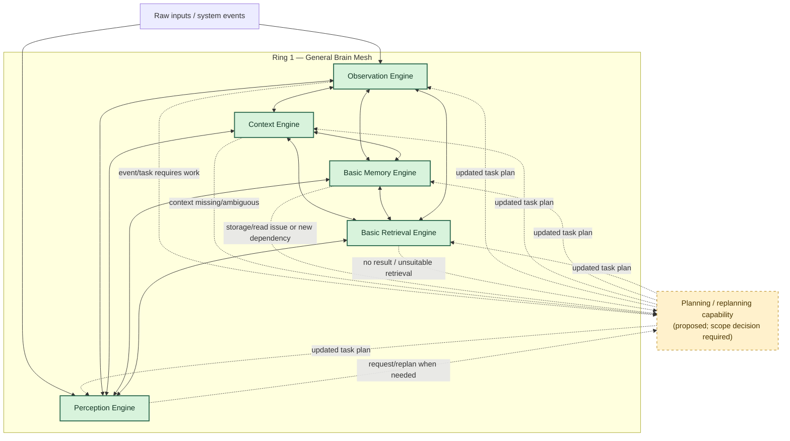
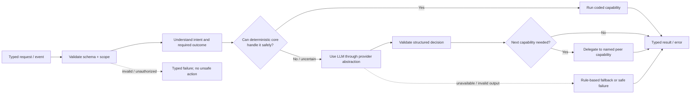
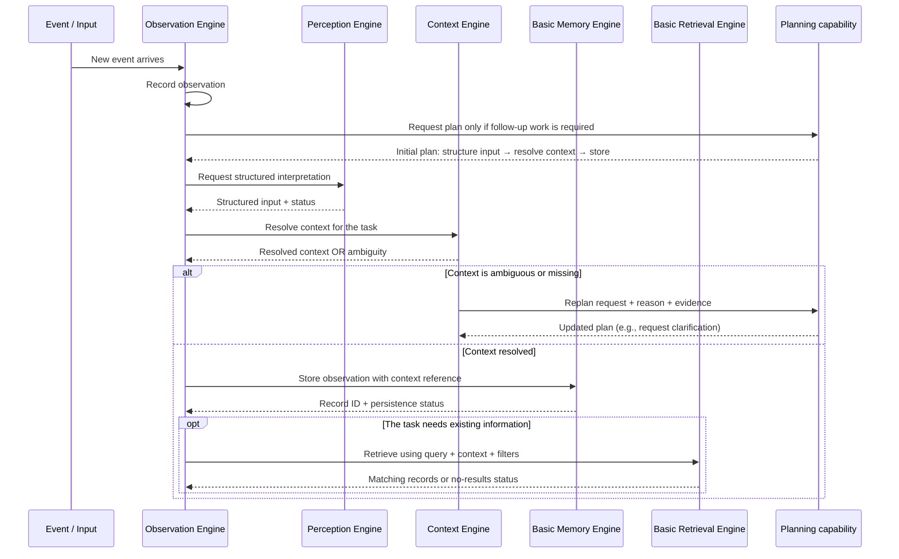
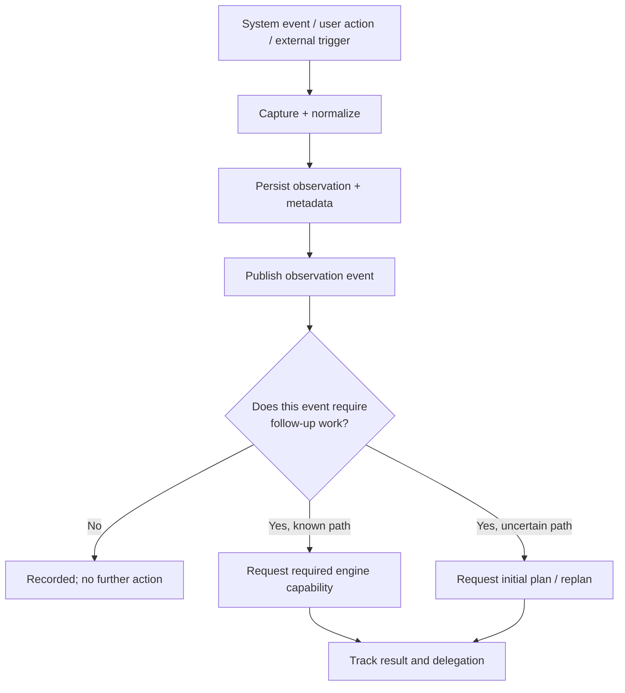
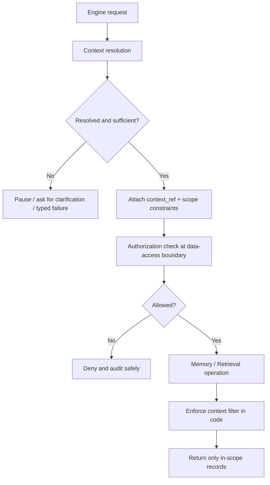

# Organizational Brain — Ring 1 AI Architecture
## General Brain Engines, Peer-to-Peer Mesh Communication, and Intelligence Layers

**Document purpose:** Define the AI team's proposed Ring 1 architecture, the responsibilities of its engines, how they communicate without a central orchestrator, and the expected input/output contracts.

**Scope:** General Brain only. This document does not define Legal-domain logic, organization-specific workflows, or case-specific intelligence.

**Source of truth:** `ORGANIZATIONAL_BRAIN_MASTER_PROJECT_CONSTITUTION.md` (v2.0). The Constitution explicitly defines five Ring 1 capabilities: **Perception, Observation, Context, Basic Memory, and Basic Retrieval**. The mesh communication and per-engine Intelligence Layer described below are the proposed implementation architecture based on the team's current direction; they should be recorded as an approved Architecture Decision Record (ADR) before implementation if they alter shared contracts.

---

## 1. The Core Idea

Ring 1 is not a collection of five isolated services, and it should not be a single centralized orchestrator that decides every step.

Instead, Ring 1 is a **peer-to-peer engine mesh**. Each engine has a clear responsibility and a stable contract. Each engine also has an **Intelligence Layer** that understands the request it receives, determines what it can do locally, and decides whether another engine's capability is needed.

The engine's core operations remain deterministic and code-driven wherever possible. The Intelligence Layer adds flexible interpretation and routing when the input is unfamiliar, ambiguous, or cannot be handled safely with predefined rules.

> **Design principle:** Code performs known, repeatable operations. Intelligence interprets uncertainty and selects the next capability. Neither is allowed to bypass context boundaries, contracts, or error handling.

### The “chocolate” model

```text
┌───────────────────────────────────────────────┐
│               INTELLIGENCE LAYER               │
│ Understand request • choose capability         │
│ select next engine • handle ambiguity/fallback  │
├───────────────────────────────────────────────┤
│                  ENGINE CORE                  │
│ Deterministic functions • parsers • validators │
│ database/API calls • schemas • error handling │
└───────────────────────────────────────────────┘
```

The Intelligence Layer is the “wrapper” around the engine's useful coded capabilities. It does **not** mean every operation must call an LLM. For example, reading a known PDF format, parsing a known JSON event, validating a schema, writing a record, or applying a known filter should normally be done with ordinary code.

---

## 2. Ring 1 Scope: The Five Engines

The Master Project Constitution defines these five Ring 1 capabilities:

1. **Perception Engine** — processes raw inputs into structured representations.
2. **Observation Engine** — continuously records/streams observed activity and events.
3. **Context Engine** — resolves and maintains contextual boundaries.
4. **Basic Memory Engine** — stores and retrieves basic records/observations.
5. **Basic Retrieval Engine** — retrieves relevant stored records under the requested context and filters.

Ring 1 is complete when the Brain can observe events, resolve their context, store observations, retrieve them, and prove context isolation through tests.

### Important scope note: Planning capability

The Constitution's Ring 1 list does **not** name a separate Planning Engine. The proposed mesh design below uses a **planning/replanning capability** to represent the task plan and revise it when an engine discovers a missing step. That capability can initially be implemented as a small shared protocol/service or as an approved addition to Ring 1. It should **not silently be treated as a sixth Constitution-defined Ring 1 engine**. If the team wants a standalone Planning Engine, document and approve that decision in an ADR.

A planning capability is not the same thing as a centralized orchestrator:
- A **central orchestrator** owns and controls every step of every workflow.
- A **planning capability** proposes and revises the plan for a task.
- The **engines themselves** execute their own capabilities and request peer capabilities when needed.
- The task plan is shared state/contract, not a global controller that must personally invoke every operation.

---

## 3. High-Level Ring 1 Mesh



**How to read the diagram:**
- Solid links represent possible peer-to-peer capability requests; they do not mean every pair needs a direct code dependency.
- Dashed links represent a request for plan creation/revision, not routine centralized execution.
- An engine may complete the task locally when its deterministic core can handle it.
- Communication should use typed, versioned contracts—not free-form English between engines.
- The diagram describes the intended architecture, not a claim that every connection is already implemented.

### Mesh does not mean “anything can call anything without rules”

The mesh must still have:
- Explicit capability declarations and input/output schemas.
- A task/correlation ID and traceable delegation history.
- Bounded retries, timeouts, and maximum delegation depth.
- Idempotency for operations that may be retried.
- Context/scope checks before any read or write.
- Clear error types and a safe stop condition.
- Tests for loops, missing capabilities, ambiguous context, and cross-context leakage.

---

## 4. Per-Engine Intelligence Layer

Every engine follows the same internal pattern:



### Decision order

1. **Validate** the request shape, version, identifiers, and context references.
2. **Check scope and authorization** before touching protected data.
3. **Try deterministic code** for known file formats, schemas, parsers, event types, database operations, and filters.
4. **Use the LLM only where interpretation or flexible planning is actually needed.**
5. **Validate the LLM's output** against a schema and allowed capabilities. Never execute arbitrary tool names or raw generated code.
6. **Delegate to a peer** through a declared capability contract when another engine is needed.
7. **Return a typed result** or a controlled error. If no safe fallback exists, fail safely rather than showing an unhandled exception to the user.

The LLM is not the source of truth for engine state, permissions, record IDs, or database writes. Those are controlled by code and trusted system state.

---

## 5. Dynamic Planning and Replanning

A task starts with a goal and available context. A plan describes the expected sequence of capabilities, expected outputs, dependencies, and stop conditions. The plan is allowed to change when an engine discovers that a step is missing or the actual output differs from the expected output.



### When an engine requests replanning

An engine must request a plan revision when, for example:
- A required input or capability was not included in the current plan.
- A downstream engine returns a typed result indicating a missing prerequisite.
- The task's assumptions no longer hold.
- The requested operation cannot be completed within the current scope.
- A safe fallback requires a different sequence of steps.

A replan request should include:
- `task_id` and `plan_version`
- `requesting_engine`
- `current_step`
- `expected_output`
- `actual_result` or typed error
- `reason_code`
- `evidence` / relevant metadata
- `context_ref`
- `proposed_capabilities` (optional suggestions, not commands)

The planning capability evaluates the request against the overall goal, current context, previous results, allowed capabilities, and stop conditions. It returns a **new plan version** starting from the failed/invalid step. Completed steps should not be repeated unless the step is explicitly marked safe to rerun or idempotent.

### Preventing endless re-planning

- Each task has a maximum number of replans and delegation steps.
- Every plan has a goal, completion criteria, and stop conditions.
- Repeated identical failures stop and return a controlled error.
- The planner cannot bypass access restrictions or grant new permissions.
- The planner cannot invent a missing context ID or treat an uncertain result as a fact.
- If a human clarification is required, the system pauses and asks for it.

---

## 6. Observation Engine: Background Monitoring vs. Action

The Constitution defines Observation as continuous monitoring of activity, with inputs such as system events, user actions, and external triggers, and output as an observation stream. It also states that the observation pipeline is asynchronous.

**Recommended separation:**

- The Observation Engine runs in the background, captures/records what happened, and emits a normalized observation.
- Observation alone does **not** mean that a user-facing action must occur.
- A separate trigger/rule or the task's Intelligence Layer determines whether the event warrants further work.
- If follow-up work is needed, it requests a plan or directly requests a declared capability when the path is known and safe.
- Observation must not silently turn an event into trusted knowledge or execute an action merely because an event occurred.



This keeps Observation responsible for **recording what happened**, while still allowing event-driven work without making Observation a centralized orchestrator.

---

## 7. Engine Specifications: Purpose, Inputs, Outputs

The contracts below are **proposed examples** to make the architecture concrete. They are not claimed to be existing class names or finalized API schemas.

### 7.1 Perception Engine [GB] — Ring 1

**Constitution purpose:** Raw input ingestion and initial processing. Inputs include text, audio, images, documents, and system events; output is a structured observation.

**Conceptual responsibility**
- Understand the incoming item's format and likely task.
- Choose a deterministic parser for known formats.
- Use an LLM for unfamiliar or semantically ambiguous inputs.
- Return structured content, metadata, status, and uncertainty.
- Request Context or another peer only when needed; do not invent organization/case identity.

**Deterministic code examples**
- Read text from a supported text file.
- Parse known JSON or a known event schema.
- Validate required fields.
- Extract metadata from a supported document type.

**LLM examples**
- Classify an unfamiliar message.
- Extract structured meaning from irregular free text.
- Interpret an input format for which no safe deterministic parser exists.

**Proposed input**
```json
{
  "task_id": "task-123",
  "input_id": "input-456",
  "source_type": "text|document|image|audio|system_event",
  "raw_content_ref": "reference-or-payload",
  "metadata": {},
  "context_hint": {},
  "expected_output": "structured_input"
}
```

**Proposed output**
```json
{
  "input_id": "input-456",
  "content_type": "text",
  "structured_content": {},
  "metadata": {},
  "processing_mode": "deterministic|llm|hybrid",
  "status": "success|partial|needs_clarification|failed",
  "uncertainty": [],
  "errors": []
}
```

**Must not do:** Grant access, fabricate context identifiers, promote observations to trusted knowledge, or assume every input requires an LLM call.

### 7.2 Observation Engine [GB] — Ring 1

**Constitution purpose:** Continuous monitoring of organizational activity. Inputs include system events, user actions, and external triggers; output is an observation stream.

**Conceptual responsibility**
- Capture and normalize events.
- Record source, timestamp, actor/source metadata, and event payload.
- Preserve traceability and event identity.
- Publish a normalized event to subscribers or the mesh.
- Decide whether an event needs follow-up only through explicit rules/capability routing—not by making every observation a task.

**Proposed input**
```json
{
  "event_id": "event-123",
  "event_type": "message.received",
  "source": "external_system",
  "timestamp": "ISO-8601",
  "actor_ref": null,
  "payload": {},
  "context_hint": {}
}
```

**Proposed output**
```json
{
  "observation_id": "obs-123",
  "event_id": "event-123",
  "event_type": "message.received",
  "source": "external_system",
  "timestamp": "ISO-8601",
  "payload_ref": "stored-payload-reference",
  "context_ref": null,
  "status": "recorded|duplicate|failed",
  "trace_id": "trace-123"
}
```

**Must not do:** Treat an event as validated knowledge or start arbitrary workflows without a declared trigger/plan.

### 7.3 Context Engine [GB] — Ring 1

**Constitution purpose:** Resolve contextual boundaries. The Constitution identifies organization, domain, case, and user as context inputs and a contextual scope as output.

**Conceptual responsibility**
- Resolve the context relevant to a task or observation.
- Preserve separation between organization/domain/case scopes.
- Report ambiguity instead of guessing.
- Provide a context reference that downstream engines must carry through reads/writes.
- Support isolation tests.

**Proposed input**
```json
{
  "task_id": "task-123",
  "context_hint": {
    "organization_id": null,
    "domain_id": null,
    "case_id": null,
    "user_id": null
  },
  "source_ref": "obs-123",
  "resolution_goal": "resolve_scope"
}
```

**Proposed output**
```json
{
  "context_ref": "ctx-123",
  "organization_id": "org-id-or-null",
  "domain_id": "domain-id-or-null",
  "case_id": "case-id-or-null",
  "user_id": "user-id-or-null",
  "resolution_status": "resolved|ambiguous|insufficient_data|failed",
  "ambiguities": [],
  "scope_constraints": []
}
```

**Must not do:** Treat context resolution as permission approval. A valid context identifies the scope; authorization is a separate control and must be enforced server-side.

### 7.4 Basic Memory Engine [GB] — Ring 1

**Constitution purpose:** Basic memory storage operations and observation persistence. Ring 1 deliverables include working basic memory storage.

**Conceptual responsibility**
- Persist and read basic records/observations.
- Associate records with context references and trace IDs.
- Support idempotent writes where retries may happen.
- Return explicit success/failure and record identifiers.
- Keep the Ring 1 scope basic; do not implement Ring 2 multi-store knowledge architecture prematurely.

**Proposed input**
```json
{
  "task_id": "task-123",
  "operation": "store_observation|get_record|update_status",
  "context_ref": "ctx-123",
  "record_type": "observation",
  "payload": {},
  "idempotency_key": "event-123"
}
```

**Proposed output**
```json
{
  "operation": "store_observation",
  "record_id": "record-123",
  "context_ref": "ctx-123",
  "status": "success|not_found|conflict|failed",
  "error": null
}
```

**Must not do:** Become the advanced multi-store Knowledge/Memory Engine from Ring 2 or automatically convert raw observations into trusted knowledge.

### 7.5 Basic Retrieval Engine [GB] — Ring 1

**Constitution purpose:** Basic retrieval logic. The Ring 1 deliverable is the ability to retrieve stored observations, with context isolation verified.

**Conceptual responsibility**
- Retrieve records for a query or direct lookup.
- Apply context and requested filters before returning results.
- Return a typed no-results status rather than inventing an answer.
- Report which records were returned so downstream capabilities can trace their evidence.
- Keep Ring 1 retrieval basic; advanced embeddings, RAG, retrieval evaluation, and multi-store coordination belong to Ring 2 in the Constitution.

**Proposed input**
```json
{
  "task_id": "task-123",
  "query": "latest event for this task",
  "context_ref": "ctx-123",
  "filters": {},
  "limit": 10
}
```

**Proposed output**
```json
{
  "query_id": "query-123",
  "items": [
    {
      "record_id": "record-123",
      "record_type": "observation",
      "context_ref": "ctx-123",
      "payload": {},
      "score": null
    }
  ],
  "status": "results_found|no_results|ambiguous|failed",
  "total": 1,
  "errors": []
}
```

**Must not do:** Retrieve records outside the supplied authorized context or pretend that basic retrieval is the full Ring 2 RAG/semantic retrieval system.

---

## 8. Shared Mesh Communication Contract

Engines should not communicate by composing English paragraphs for one another. They should use a shared, low-level, machine-readable protocol. “Their own language” means **typed structured contracts**, not a new natural language or unrestricted LLM-generated tool calls.

### Proposed message envelope

```json
{
  "protocol_version": "1.0",
  "message_id": "msg-123",
  "task_id": "task-123",
  "trace_id": "trace-123",
  "parent_message_id": null,
  "sender_engine": "perception",
  "recipient_capability": "context.resolve",
  "message_type": "capability_request",
  "plan_version": 1,
  "context_ref": "ctx-hint-or-null",
  "deadline": "ISO-8601",
  "payload": {},
  "constraints": {
    "max_delegations_remaining": 5,
    "idempotency_key": null
  }
}
```

### Standard response envelope

```json
{
  "protocol_version": "1.0",
  "message_id": "msg-124",
  "in_reply_to": "msg-123",
  "task_id": "task-123",
  "trace_id": "trace-123",
  "sender_engine": "context",
  "message_type": "capability_result",
  "status": "success|partial|needs_clarification|replan_required|failed",
  "payload": {},
  "errors": [],
  "context_ref": "ctx-123",
  "plan_version": 1
}
```

### Rules
1. Use stable capability names, not arbitrary generated function names.
2. Validate every request and response against a schema.
3. Keep IDs, timestamps, context references, statuses, and error codes machine-readable.
4. Carry `task_id`, `trace_id`, and `context_ref` across every delegation.
5. Every data access must enforce the scope and authorization rules.
6. Keep raw sensitive content out of logs where it is not required; log references and safe metadata instead.
7. A response may be `partial`, `ambiguous`, `needs_clarification`, or `failed`; do not force every engine to claim success.
8. An LLM may propose a capability call, but code validates that the capability exists, is allowed, and has valid arguments before dispatch.
9. Set timeouts, retry limits, idempotency, and delegation-depth limits.
10. Keep a trace of requests, responses, plan versions, and replan reasons.

---

## 9. Context and Isolation: A Non-Negotiable Boundary

The Constitution requires organization and case isolation. It explicitly says Case A knowledge must never leak into Case B, including when both cases belong to the same client.

For Ring 1, this means:
- Context must be resolved or explicitly marked unknown/ambiguous before a context-sensitive read/write.
- Every stored record must carry a context reference or a documented reason why it is global.
- Every retrieval request must carry its context/scope.
- A downstream engine cannot widen the scope on its own.
- The Intelligence Layer and planner cannot override isolation.
- Missing context should trigger clarification/replanning or a safe stop—not a guess.
- Tests must prove that observations from one context are not visible in another.



Context is not a prompt-only instruction. Isolation must be enforced in code at the data-access boundary.

---

## 10. What Ring 1 Is—and Is Not

### Ring 1 includes
- Perception for raw input and initial structuring.
- Observation capture/normalization and an observation stream.
- Context resolution for organization/domain/case/user scope.
- Basic storage and reading of observations.
- Basic retrieval under explicit context/filters.
- Shared engine contracts, traceability, deterministic fallbacks, and error handling needed to make the five engines work together.
- Unit/integration tests, especially context isolation.

### Ring 1 does not include as full capabilities
- Knowledge extraction and promotion to trusted knowledge.
- Advanced multi-store storage.
- Full semantic RAG/embeddings/retrieval evaluation.
- Domain-specific Legal reasoning or other domain-specific engines.
- Organization-specific policy learning.
- Case intelligence beyond the basic context boundary.
- Full reasoning/assistance, learning/validation, insights, or advanced autonomy.

These boundaries follow the Ring 1 and Ring 2 definitions in the Constitution. If the mesh needs a planning/replanning capability, its status must be agreed and documented as described in Section 2.

---

## 11. Suggested Acceptance Tests

A Ring 1 implementation should not be considered complete because the five engine classes exist. It should demonstrate the behavior end-to-end.

### Perception
- Known text/JSON/document formats use deterministic code.
- Unknown or semantically ambiguous inputs can use the configured LLM path.
- Invalid LLM output is rejected or safely handled.
- Provider failure does not crash the process or expose a stack trace to the user.

### Observation
- Events are captured and normalized.
- Duplicate event handling is deterministic.
- An observation is recorded even when no follow-up task is needed.
- Observation does not automatically promote an event to trusted knowledge.
- A follow-up task is triggered only by an explicit rule or a valid plan request.

### Context
- Correct organization/domain/case references are returned when evidence is sufficient.
- Missing or ambiguous identifiers are not invented.
- Context resolution and authorization remain separate.
- Cross-context tests prove that one scope cannot see another scope's records.

### Basic Memory
- Records can be stored and read back.
- Each record retains its context reference and trace metadata.
- Retries do not create unintended duplicates when idempotency is required.
- Database failures return typed errors.

### Basic Retrieval
- Stored observations can be retrieved by direct query/filter.
- Results are restricted to the requested context.
- No-results responses are explicit.
- Retrieval failure does not fabricate results.

### Mesh / Planning
- An engine can delegate to another engine using a typed capability contract.
- The receiver validates the request and returns a typed response.
- A missing prerequisite can request replanning with a reason and evidence.
- Replanning creates a new plan version and resumes from the appropriate step.
- Maximum retries/delegations prevent loops.
- A failed peer returns a controlled status; the caller can fallback, replan, ask for clarification, or stop safely.
- Trace records show the task path without requiring a central orchestrator to own every operation.

---

## 12. Decisions to Confirm Before Implementation

1. **Planning capability ownership:** The Constitution lists five Ring 1 engines and does not list a separate Planning Engine. Decide whether planning/replanning is a small shared capability within Ring 1 or an approved sixth engine, and record it in an ADR.
2. **Mesh transport:** Decide whether peer calls are direct in-process service calls, an internal message bus, or a hybrid. The architecture can be peer-to-peer without requiring network calls between every pair.
3. **Observation trigger policy:** Define which event types are record-only and which trigger follow-up work. Do not make every observation an action.
4. **Contract versioning:** Define the shared request/response envelope and schemas before the five engines are implemented independently.
5. **LLM boundaries:** For each capability, list deterministic cases, LLM-assisted cases, output validation, fallback, evaluation, and failure modes.
6. **Context enforcement:** Agree where context references are resolved and where isolation is enforced. Context must be enforced in code, not merely described in prompts.
7. **Ring 1 versus Ring 2:** Keep Ring 1 retrieval and memory basic. Advanced knowledge extraction, multi-store coordination, provenance, embeddings, and RAG belong to Ring 2 in the Constitution.

---

## 13. Final Architecture Summary

```text
                 RING 1 — GENERAL BRAIN
┌────────────────────────────────────────────────────────────┐
│                                                            │
│  Perception  ↔  Observation  ↔  Context                    │
│       ↕              ↕             ↕                       │
│  Basic Memory   ↔   Basic Retrieval                        │
│                                                            │
│  Every engine:                                             │
│  [Intelligence Layer] + [Deterministic Core]               │
│  typed contracts • context checks • errors • tracing      │
│                                                            │
│  Peer-to-peer delegation; no central orchestrator          │
│  Planning/replanning capability: proposed, decision needed │
│                                                            │
└────────────────────────────────────────────────────────────┘
             ↓
 Ring 1 outcome: observe → structure → resolve context
             → store → retrieve, with isolation verified

 Ring 2 later adds: Knowledge Engine, advanced Memory/Storage,
 Provenance, embeddings, advanced Retrieval/RAG, and evaluation.
```

**Ring 1's goal is not to build the whole intelligence platform at once.** It is to establish five reusable General Brain capabilities with reliable contracts, safe deterministic behavior, LLM assistance only where needed, dynamic peer-to-peer communication, and verified context isolation.
