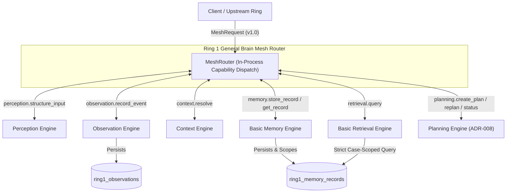

# Ring 1 General Brain Architecture: Comprehensive Technical Report

**Project**: Organizational Brain (Legal V1)  
**Ring**: Ring 1 — General Brain (Peer-to-Peer Capability Mesh)  
**Date**: October 27, 2026  
**Status**: Completed, Fully Tested, and Committed (`19892ba5`)  
**Lead Engineer / Architect**: Antigravity  

---

## 1. Executive Summary

Ring 1 ("General Brain") establishes the core intelligent execution foundation of the Organizational Brain system. Rather than creating a brittle, monolithic pipeline or an authoritarian central orchestrator, Ring 1 implements a **peer-to-peer capability mesh**. 

In this architecture, six specialized peer engines cooperate through structured, versioned envelopes (`MeshRequest` and `MeshResponse`). Each engine adheres to the **Deterministic Core + Intelligence Layer** paradigm: deterministic business rules, schemas, idempotency guards, and context boundaries run first and authoritatively; LLM inference is used strictly for classification, extraction, intent expansion, and plan generation with structured validation and safe fallback.

All requirements from the Project Constitution, `RING_1_AI_ARCHITECTURE_MESH.md`, and project decisions (D-001 through D-016) have been implemented, verified, and documented.



---

## 2. Core Architectural Invariants & Patterns

### 2.1 Peer-to-Peer Mesh (Anti-Orchestrator Pattern)
- **No Dictator Orchestrator**: The `MeshRouter` is a lightweight infrastructure service for capability discovery, argument validation, timeout enforcement, and trace propagation. It does not dictate workflows or state machines.
- **Autonomous Peer Delegation**: Any engine can delegate sub-tasks to peer capabilities via `self._delegate()`. Every delegation automatically decrements `max_delegations_remaining` (default 10) to mathematically prevent infinite recursion loops.
- **Standardized Envelopes**: All inter-engine communication is strictly mediated by typed Pydantic models:
  - `MeshRequest`: carries `message_id`, `task_id`, `trace_id`, `parent_message_id`, `context_ref`, `constraints`, and `payload`.
  - `MeshResponse`: carries `in_reply_to`, correlation IDs, `status` (`ResultStatus`), structured `payload`, and typed `errors` (`MeshError`).
  - `EngineErrorCode`: typed error codes so engines never leak raw Python stack traces.

### 2.2 Deterministic Core + Intelligence Layer
Every engine derives from `BaseEngine`:
1. **Deterministic Core First**: Validate input payload types, verify delegation depth, enforce contextual isolation boundaries (`case_id`), and check idempotency.
2. **Intelligence Layer Assisted**: When deterministic parsing or rule evaluation is insufficient (e.g. irregular text, missing categorizations, complex goals), call `LLMService` via the provider abstraction.
3. **Output Validation & Fallback**: All LLM outputs are validated against Pydantic schemas or strict allowlists. If the LLM returns malformed content or is unavailable, the engine gracefully falls back to deterministic behaviors.

### 2.3 Strict Case-Level Isolation (Legal Invariant)
Per decisions D-004 and D-006:
- The system operates as a single-organization deployment per instance.
- **Case isolation is non-negotiable**: Data belonging to `case_id: "case-AAA"` must never be readable, queryable, or leaked to `case_id: "case-BBB"`.
- Context resolution verifies case identity; Memory Engine rejects reads across case boundaries with `AUTHORIZATION_DENIED`; Retrieval Engine filters all SQL and in-memory queries strictly by `case_id`.

---

## 3. Detailed Component Breakdown

### 3.1 Contracts & Capability Registry (`backend/app/ring1/contracts/`)
| Module | Responsibility | Key Classes / Constants |
|---|---|---|
| `envelopes.py` | Message envelopes and constraints | `MeshRequest`, `MeshResponse`, `MeshConstraints` (`DelegationConstraints`), `MeshError`, `ResultStatus` |
| `capabilities.py` | Capability allowlist & directory | `ALL_CAPABILITIES`, `CapabilityRegistry`, `CapabilityEntry` |
| `context_ref.py` | Context boundary model | `ContextRef`, `ResolutionStatus` (`EXPLICIT`, `RESOLVED`, `AMBIGUOUS`, etc.) |
| `errors.py` | Standard error definitions | `EngineErrorCode` |
| `plan_models.py` | Plan lifecycle & replan models | `Plan`, `PlanStep`, `PlanStatus`, `StepStatus`, `ReplanRequest`, `ReplanResponse` |

#### Registered Capabilities
```python
ALL_CAPABILITIES = frozenset({
    "perception.structure_input",
    "observation.record_event",
    "context.resolve",
    "memory.store_record",
    "memory.get_record",
    "retrieval.query",
    "planning.create_plan",
    "planning.request_replan",
    "planning.get_plan_status",
})
```

---

### 3.2 The Six Ring 1 Engines (`backend/app/ring1/engines/`)

#### 1. Perception Engine (`perception.py`)
- **Capability**: `perception.structure_input`
- **Deterministic Core**: Automatically detects and parses JSON payloads, plain text documents, and system events. Computes word counts, line counts, and metadata keys. Explicitly rejects unhandled binary executable types with `UNSUPPORTED_INPUT_TYPE`.
- **Intelligence Layer**: Decomposes irregular free-form text or documents using LLM extraction when structure cannot be determined deterministically.

#### 2. Observation Engine (`observation.py`)
- **Capability**: `observation.record_event`
- **Deterministic Core**: Captures system events, normalizes payloads, and evaluates duplicate status using unique `idempotency_key` indexes.
- **Event Policies**: Categorizes events into record-only (e.g. `heartbeat`, `log_entry`) versus follow-up triggers (e.g. `document.uploaded`, `case.created`).
- **Persistence**: Persists to `ring1_observations` in PostgreSQL or in-memory when detached.

#### 3. Context Engine (`context.py`)
- **Capability**: `context.resolve`
- **Deterministic Core**: Resolves context hints (`organization_id`, `case_id`, `domain_id`, `user_id`).
- **Boundary Verification**: Since `case_id` is the primary legal isolation key, any context hint missing `case_id` is flagged as `AMBIGUOUS` with `NEEDS_CLARIFICATION`, preventing downstream data leakage.
- **Intelligence Layer**: High-confidence inference of missing metadata from payload references, never fabricating IDs.

#### 4. Basic Memory Engine (`memory.py`)
- **Capabilities**: `memory.store_record`, `memory.get_record`
- **Deterministic Core**: Requires valid `context_ref`. Stores records tagged with `case_id`, `context_ref`, `record_type`, `trace_id`, and payload in `ring1_memory_records`.
- **Isolation Guard**: When retrieving a record by ID, verifies that the requesting context matches the record's `case_id`. Cross-case access is blocked immediately with `AUTHORIZATION_DENIED`.
- **Idempotency**: Prevents duplicate insertions when an `idempotency_key` is repeated.

#### 5. Basic Retrieval Engine (`retrieval.py`)
- **Capability**: `retrieval.query`
- **Deterministic Core**: Requires a resolved `case_id`. All database and in-memory queries are strictly filtered by `case_id == expected_case_id`. Foreign records are filtered out at the SQL query level and checked again in application logic (defense-in-depth).
- **Matching & Pagination**: Supports filtering by `record_type`, pagination (`limit`, `offset`), and multi-attribute keyword matching across `payload`, `metadata`, and `record_type`.
- **Intelligence Layer**: Keyword expansion and query intent extraction via LLM.

#### 6. Planning Engine (`planning.py` — ADR-008)
- **Capabilities**: `planning.create_plan`, `planning.request_replan`, `planning.get_plan_status`
- **Deterministic Core**: 
  - Generates versioned `Plan` objects with sequenced `PlanStep`s.
  - **Capability Allowlist Check**: Validates that 100% of proposed steps reference capabilities in `ALL_CAPABILITIES`. Unknown capabilities are rejected.
  - **Bounded Replanning**: Enforces `max_replans` (default 3 to 5). If replan attempts exceed the threshold, transitions plan to `FAILED` and halts with `REPLAN_LIMIT_EXCEEDED` to eliminate infinite loops.
- **Intelligence Layer**: Prompts LLM to decompose unstructured legal goals into registered capabilities, falling back to a deterministic 4-step sequence if the LLM is unavailable.

---

### 3.3 Database Architecture & Alembic Migration

Two new PostgreSQL tables were created via Alembic revision `f19a0a1b2c3d_create_ring1_tables.py`, inheriting from `Base` and chaining from revision `e819b932c01a`.

#### `ring1_observations` Table
| Column | Type | Constraints / Indexes |
|---|---|---|
| `id` | `UUID` | Primary Key, default `gen_random_uuid()` |
| `event_id` | `VARCHAR(255)` | Not Null |
| `event_type` | `VARCHAR(255)` | Not Null, Indexed |
| `source` | `VARCHAR(255)` | Not Null |
| `context_ref` | `VARCHAR(255)` | Nullable, Indexed |
| `case_id` | `VARCHAR(255)` | Nullable, Indexed |
| `organization_id` | `VARCHAR(255)` | Nullable |
| `payload` | `JSONB` | Nullable |
| `metadata` | `JSONB` | Nullable |
| `trace_id` | `VARCHAR(255)` | Nullable, Indexed |
| `task_id` | `VARCHAR(255)` | Nullable |
| `idempotency_key`| `VARCHAR(500)` | Unique Index (Partial: `WHERE idempotency_key IS NOT NULL`) |
| `status` | `VARCHAR(50)` | Default `'recorded'` |
| `event_timestamp`| `TIMESTAMPTZ` | Nullable |
| `created_at` | `TIMESTAMPTZ` | Default `now()`, Indexed |

#### `ring1_memory_records` Table
| Column | Type | Constraints / Indexes |
|---|---|---|
| `id` | `UUID` | Primary Key, default `gen_random_uuid()` |
| `record_type` | `VARCHAR(100)` | Not Null, Indexed |
| `context_ref` | `VARCHAR(255)` | Nullable, Indexed |
| `case_id` | `VARCHAR(255)` | Nullable, Indexed |
| `organization_id` | `VARCHAR(255)` | Nullable |
| `payload` | `JSONB` | Nullable |
| `metadata` | `JSONB` | Nullable |
| `trace_id` | `VARCHAR(255)` | Nullable, Indexed |
| `task_id` | `VARCHAR(255)` | Nullable |
| `source_observation_id` | `UUID` | Nullable |
| `idempotency_key`| `VARCHAR(500)` | Unique Index (Partial: `WHERE idempotency_key IS NOT NULL`) |
| `status` | `VARCHAR(50)` | Default `'active'` |
| `created_at` | `TIMESTAMPTZ` | Default `now()`, Indexed |
| `updated_at` | `TIMESTAMPTZ` | Default `now()` |

---

## 4. Verification and Test Results

### 4.1 Ring 1 Dedicated Test Suite (`backend/tests/ring1/`)
34 automated tests across 8 test modules were developed and executed using `pytest`:

| Test Suite | Test Count | Key Invariants Verified | Status |
|---|---|---|---|
| `test_contracts.py` | 6 | Request/response envelopes, defaults, validation, immutability, `ContextRef`, `CapabilityRegistry` allowlist | **PASSED** |
| `test_perception.py` | 5 | Deterministic JSON/text/system_event parsing, line/word counts, unsupported binary type rejection | **PASSED** |
| `test_observation.py`| 3 | Normalization, idempotency deduplication, record-only vs follow-up triggers | **PASSED** |
| `test_context.py` | 3 | Explicit resolution, missing `case_id` ambiguity detection, empty hint failure | **PASSED** |
| `test_memory.py` | 4 | Store/get, context_ref enforcement, idempotency, cross-case access block | **PASSED** |
| `test_retrieval.py` | 3 | Contextual search, missing case rejection, record_type and keyword filters | **PASSED** |
| `test_planning.py` | 4 | Goal decomposition, 100% registered capability validation, bounded replanning exhaustion, plan status lifecycle | **PASSED** |
| `test_mesh_integration.py` | 4 | Router dispatch, unregistered capability rejection, parent-child trace propagation, delegation depth exhaustion | **PASSED** |
| `test_context_isolation.py` | 2 | End-to-end cross-case isolation in memory AND in PostgreSQL (`db_session` fixture) | **PASSED** |
| **Total Ring 1 Tests** | **34** | **100% Pass Rate** | **PASSED** |

### 4.2 Full Repository Regression Run
```bash
.venv/bin/pytest backend/tests ai/tests
```
**Result**: **212 passed in 6.17s** (0 failures, 0 regressions across auth, AI providers, ingestion, sources, security, and Ring 1).

---

## 5. Architectural Decision Record & Governance

### ADR-008: Planning Engine as 6th Engine
- **File**: `docs/adrs/ADR-008-planning-engine.md`
- **Context**: The historical Constitution listed five Ring 1 capabilities. Multi-step goal decomposition, status tracking, and structured replanning required a dedicated Planning Engine.
- **Decision**: Adopted Planning Engine as the 6th engine without altering the historical Constitution text.
- **Boundaries**: Planning Engine generates plans; it **never executes them**. Engines execute their own capabilities across the peer mesh.

### Decision D-016
- **File**: `docs/backend/decisions.md`
- Formalized the Ring 1 Mesh Architecture, in-process routing, and case-level isolation constraints.

---

## 6. Git Commit Details

- **Commit**: `19892ba5b4dc28ee491f6eda1af55903a1e6b356`
- **Branch**: `main`
- **Message**: `feat(ring1): implement Ring 1 General Brain peer-to-peer mesh architecture`
- **Diff Stat**: `41 files changed, 4780 insertions(+), 6 deletions(-)`
- **Files Staged**: Explicitly by path (no `-A` or `.` used; `.env` and `.venv` strictly excluded).
