# Anatomical Brain Source-to-Production Mapping Strategy
## From Standalone Viewer (`http://localhost:8862/`) to Brain-Co Production Hero

**Document Location:** `frontend/docs/anatomical-brain-production-mapping.md`  
**Execution Date:** 2026-11-17T19:02:00+02:00  
**Status:** **APPROVED & IN EXECUTION**

---

## 1. Standalone Viewer Architecture Audit

### 1.1 Source Model & Loaded Geometry
- **Source Asset**: `dala-inspection/brain-anatomy-research/models/original/brain.glb` (4,650,816 bytes, Draco compressed).
- **Metadata Manifest**: `dala-inspection/brain-anatomy-research/models/original/manifest.json` (228 KB, 437 named structures).
- **Runtime Execution**:
  - The standalone viewer at `http://localhost:8862/` directly loads `brain.glb` using Three.js `GLTFLoader` with `DRACOLoader`.
  - At runtime, Draco decompressor extracts **563 primitives / meshes** across **437 anatomical structures**.
  - Verified Live Telemetry:
    - **Total Meshes**: 563
    - **Total Vertices**: 853,972
    - **Total Triangles**: 1,383,522
  - Subsystem Breakdown:
    - **Cerebral Cortex**: 128 meshes, 252,020 vertices, 361,072 triangles (covers 100% of the visible gyri and sulci).
    - **Cerebellum**: 33 meshes, 126,409 vertices, 224,563 triangles (sub-occipital folia and hemispheres).
    - **Brainstem**: 30 meshes, 48,428 vertices, 74,436 triangles (pons, medulla, midbrain stalk).
    - **Internal Subcortical & Vascular Structures**: 372 meshes (deep grey matter, ventricles, tracts, Circle of Willis arteries, dural sinuses). These structures reside deep inside the cerebral vault and are visually occluded by the cortex.

### 1.2 Coordinate System, Scale & Centering
- **Native Z-Anatomy Coordinate System**:
  - $+X$: Right lateral, $-X$: Left lateral. Width $\approx 0.152\text{ m}$.
  - $+Y$: Superior (dorsal cranial vault), $-Y$: Inferior (brainstem). Height $\approx 0.597\text{ m}$.
  - $+Z$: Anterior (frontal pole), $-Z$: Posterior (occipital pole, cerebellum). Depth $\approx 0.200\text{ m}$.
- **Center of Mass Normalization**:
  - The viewer calculates `bbox.getCenter()` and shifts the entire model hierarchy by `-modelCenter`.
  - The resulting anatomical center of the cerebral hemispheres is precisely at $(0, 0, 0)$.
- **Framing & Camera Geometry**:
  - `PerspectiveCamera` with FOV = 38° (low geometric perspective distortion).
  - Primary Left Lateral View: Camera at $(-0.44, 0.02, 0.0)$ pointing at $(0, 0, 0)$.
  - Screen Alignment from this viewpoint:
    - Looking along $+X$:
    - Frontal pole ($+Z$) is oriented to the **LEFT**.
    - Occipital pole & cerebellum ($-Z$) are oriented to the **RIGHT**.
    - Cranial vault ($+Y$) is oriented to the **TOP**.
    - Brainstem ($-Y$) is oriented to the **BOTTOM**.
    - This corresponds exactly to Dala's benchmark composition and Brain-Co's Hero section layout!

### 1.3 Material & Lighting Configuration
- **Materials**: `MeshStandardMaterial` with `roughness: 0.62`, `metalness: 0.04`, `side: THREE.DoubleSide`.
  - Cortex: `#d8d4cb` (ivory clay).
  - Cerebellum: `#dfbe92` (folia ochre).
  - Brainstem: `#c8b29e` (stalk tan).
- **Lighting**: 3-point neutral illumination:
  - Ambient: intensity 0.65.
  - Warm Key Light: intensity 1.25 at $(1.5, 2.0, 1.8)$.
  - Cool Fill Light: intensity 0.65 at $(-2.0, -0.8, 1.0)$.
  - Rim Back Light: intensity 0.55 at $(0.0, 1.5, -2.5)$.

---

## 2. Source-to-Production Mapping Pipeline

```mermaid
flowchart LR
    A["Validated Source GLB (brain.glb)"] --> B["1. Exterior Anatomical Filter (191 Meshes)"]
    B --> C["2. Area-Weighted Surface Sampling (16,000 Shards)"]
    C --> D["3. Surface Normal & Curvature Encoding"]
    D --> E["4. Faceted Tetrahedral Shards (piramed-faces)"]
    E --> F["5. Production Engine Integration (exact-brain-geometry.ts)"]
    F --> G["6. Dala-Grade Specular & Wireframe Shaders"]
    G --> H["7. Hero Viewport Presentation (State 0 at x=+1.48)"]
```

### 2.1 Step 1: Exterior Anatomical Shell Extraction
We extract only the 191 meshes forming the visible exterior envelope:
- 128 cortical meshes (left & right hemispheres, precentral/postcentral, superior/middle/inferior temporal, occipital, cuneus, precuneus, lingual, fusiform).
- 33 cerebellar meshes (hemispheres & vermis folia).
- 30 brainstem meshes (pons, midbrain, medulla).
Internal structures (ventricles, caudate, putamen, thalamus, vasculature) are excluded to prevent inner geometry clutter and avoid occlusion artifacts.

### 2.2 Step 2: Area-Weighted Surface Sampling with Normal Preservation
Unlike 2D photographic peak extraction (which created the amorphous cloud in Image 1), 3D surface sampling operates directly on the authentic anatomical triangles:
1. For each triangle in the 191 exterior meshes, compute surface area $A_i = \frac{1}{2} \|(\mathbf{v}_1 - \mathbf{v}_0) \times (\mathbf{v}_2 - \mathbf{v}_0)\|$.
2. Cumulative area distribution enables uniform probability sampling across all gyri, folia, and sulcal walls.
3. For each sampled point:
   - Compute barycentric interpolation of positions: $\mathbf{p} = (1 - \sqrt{r_1})\mathbf{v}_0 + \sqrt{r_1}(1 - r_2)\mathbf{v}_1 + \sqrt{r_1}r_2\mathbf{v}_2$.
   - Compute barycentric interpolation of true vertex normals: $\mathbf{n} = \text{normalize}((1 - \sqrt{r_1})\mathbf{n}_0 + \sqrt{r_1}(1 - r_2)\mathbf{n}_1 + \sqrt{r_1}r_2\mathbf{n}_2)$.
   - Compute local curvature / sulcal depth metric $\kappa$.
   - Compute anatomical region classification (frontal, temporal, parietal, occipital, cerebellar, brainstem).
   - Compute rim view factor $\rho = 1.0 - |\mathbf{n} \cdot \mathbf{v}_{\text{view}}|$ for edge glow assignment.

### 2.3 Step 3: Faceted Polyhedra Decomposition (`piramed-faces`)
Every sample point anchors an instanced 3D tetrahedral pyramid matching Dala's reverse-engineered `piramed-faces`:
- 4 triangular faces with non-shared flat normals (sharp specular glints).
- Shard orientation: base aligned perpendicular to the surface normal $\mathbf{n}$, apex pointing slightly outward along $\mathbf{n}$.
- Screen-space barycentric coordinates for single-pass anti-aliased wireframe edges (`fwidth`).
- Curvature-adaptive scaling: smaller shards ($s \approx 0.02$) in deep sulci and cerebellar folia, standard shards ($s \approx 0.04$) on gyral crests, and anchored macro crystals ($s \approx 0.10$).

### 2.4 Step 4: Production Engine Integration
In `frontend/src/components/cinematic/`:
1. **Coordinate Normalization**:
   - The sampled anatomical coordinates are centered at $(0,0,0)$ and scaled to fit Brain-Co's world units ($\text{radius} \approx 1.25\text{ units}$).
   - Orientation: Rotate coordinates so that when the camera is along $+Z$, the Left Lateral aspect faces the user (Frontal pole to Left, Occipital/Cerebellum to Right, Cranial Vault to Top, Brainstem to Bottom).
2. **Hero Presentation (State 0, `u_progress = 0.0`)**:
   - Positioned in right visual column: $x = +1.48, y = +0.10, \text{scale} = 0.95$.
   - Visible immediately on page load without scrolling.
   - Text column ($x \in [-3.6, -0.3]$) remains pristine obsidian black.
   - Dynamic responsive compensation for mobile viewports ($x = -1.48 \times 0.65 \times (1 - \text{progress})$).
3. **4-Stage Narrative Morphing**:
   - State 0: Fully Assembled Anatomical Shard Brain in Hero.
   - State 1: Fragmentation Scatter (Crisis section).
   - State 2: Inward Convergence Streamlines (Convergence section).
   - State 3: Coalesced Dual-Hemisphere Brain (Platform Preview / Final sections).

### 2.5 Step 5: Dala-Grade Specular & Wireframe Shader
- **Fragment Shader (`dala-frag.ts`)**:
  - Flat-facet Blinn-Phong specular lighting reflecting the key, fill, and rim lights.
  - Screen-space wireframe anti-aliasing via `min(min(vBarycentric.x, vBarycentric.y), vBarycentric.z)` and `fwidth()`.
  - Color mapping:
    - Golden-amber (`#ffb829`) on outer silhouette edges.
    - Platinum white (`#fafaff`) on dorsal crest specular glints.
    - Subtle iridescent cyan & violet on temporal/parietal facets.
    - Deep obsidian / charcoal in sulcal valleys and base core.
  - Neural respiration idle pulsation (period $4.5\text{s}$, amplitude $1.2\%$).

---

## 3. Measurable Verification & Acceptance Protocol

| Step | Verification Gate | Metric / Tool | Pass Criteria |
|---|---|---|---|
| **V1** | Geometric Deviation | Bounding box & centroid deviation | $\le 2.5\%$ cranial bounding diameter |
| **V2** | Silhouette Overlap | 2D silhouette comparison against standalone viewer | $\ge 92\%$ mask overlap across all 5 standard views |
| **V3** | Landmark Audit | Visual inspection | Longitudinal fissure, Sylvian notch, cerebellar folia, brainstem clearly defined |
| **V4** | TypeScript & Tests | `npm --prefix frontend run typecheck` & `npm test` | 0 errors, 16/16 unit tests passing |
| **V5** | Next.js Build | `npm --prefix frontend run build` | 37/37 static pages generated cleanly |
| **V6** | Real Browser Captures | Headless Chrome CDP (1440×900, 1920×1080, 390×844) | Zero console errors, 60 FPS, zero text collision |

---

## 4. Protected Files & Safety Invariants
- `frontend/src/proxy.ts` — **UNTOUCHED**
- `frontend/src/lib/server-backend-url.ts` — **UNTOUCHED**
- `frontend/src/lib/backend-auth.ts` — **UNTOUCHED**
- `frontend/src/hooks/use-observation-ws.ts` — **UNTOUCHED**
- `frontend/src/app/api/**/*` — **UNTOUCHED**
- `frontend/src/components/workspace/**/*` — **UNTOUCHED**
- `frontend/src/components/ring1-test-console/**/*` — **UNTOUCHED**
- `frontend/src/app/workspace/**/*` — **UNTOUCHED**
- `frontend/src/app/login/**/*` — **UNTOUCHED**
- `frontend/src/app/onboarding/**/*` — **UNTOUCHED**
- Backend, Docker, migrations — **100% UNTOUCHED**
- Zero git commits, zero staging (`git add`), zero resets.
